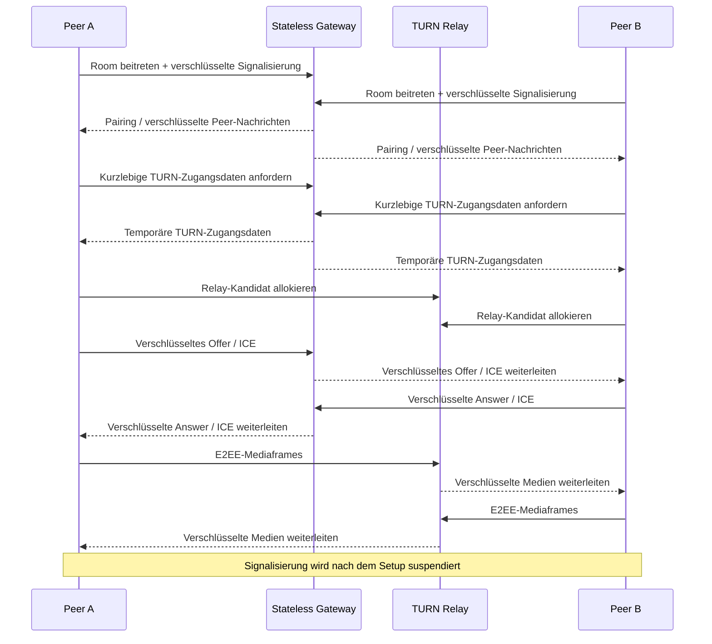

# LiveHide

### Datenschutzorientierte 1:1-Audio-/Videokommunikation mit Relay-only WebRTC und E2EE auf Anwendungsebene

<a href="./README.md">English</a> · <a href="./README.de.md"><strong>Deutsch</strong></a> · <a href="./README.tr.md">Türkçe</a>

  
  
  

---

## Überblick

LiveHide ist eine datenschutzorientierte Echtzeit-Kommunikationsplattform für 1:1-Audio- und Videoanrufe.

Die Architektur trennt Signalisierung und Medientransport. Ein zustandsloses Go-Gateway koordiniert Room-Mitgliedschaft, verschlüsselte Signalisierungsnachrichten und kurzlebige TURN-Zugangsdaten. Die WebRTC-Medien werden ausschließlich über authentifizierte TURN-Relays transportiert und zusätzlich durch Ende-zu-Ende-Verschlüsselung auf Anwendungsebene geschützt.

## Technische Architektur

LiveHide verwendet einen TypeScript/Vite-Browserclient und ein Go-Gateway mit bewusst minimalem serverseitigem Zustand.

Beim Verbindungsaufbau:

1. Peers treten über das Signalisierungs-Gateway einem Room bei.
2. Peer-Beziehung und kryptografischer Zustand werden aufgebaut.
3. SDP- und ICE-Nachrichten werden in verschlüsselten Envelopes ausgetauscht.
4. Die Clients beziehen kurzlebige TURN-Zugangsdaten.
5. WebRTC wird mit `iceTransportPolicy: "relay"` erstellt.
6. Host-, server-reflexive und peer-reflexive Kandidaten werden verworfen.
7. Das gewählte Kandidatenpaar wird über `RTCPeerConnection.getStats()` überprüft.
8. Media-E2EE wird über WebRTC Encoded Transforms installiert.
9. Eine Short Authentication String (SAS) ermöglicht Peer-Verifikation.
10. Die Signalisierung wird nach dem Setup suspendiert und nur bei kontrollierter ICE-Wiederherstellung erneut geöffnet.

### Kern-Stack

`Go` · `TypeScript` · `Vite` · `WebRTC` · `WebSocket` · `coturn` · `Caddy` · `Docker` · `WebCrypto`

## Technischer Deep Dive

Das Privacy-Modell wird zur Laufzeit durchgesetzt und nicht nur als Designziel beschrieben. Ein Anruf beginnt mit der Room-Koordination über das Go-Signalisierungs-Gateway, das jedoch keine Klartext-SDP- oder ICE-Nachrichten erhält. Signalisierungsdaten werden in authentifizierte AES-256-GCM-Envelopes verpackt, über Additional Authenticated Data an ihren Nachrichtenkontext gebunden und durch monoton steigenden Sequenzzustand gegen Replay geschützt.

Nach Aufbau der Peer-Beziehung beziehen beide Clients kurzlebige coturn-Zugangsdaten und erzeugen ihre `RTCPeerConnection` mit `iceTransportPolicy: "relay"`. Die Implementierung verlässt sich nicht ausschließlich auf diese Browseroption: Host-, server-reflexive und peer-reflexive Kandidaten werden gefiltert. Nach der ICE-Aushandlung wird das tatsächlich gewählte Kandidatenpaar über `RTCPeerConnection.getStats()` geprüft. Eine Sitzung gilt erst dann als sicher verbunden, wenn der aktive Transportpfad tatsächlich über ein Relay läuft.

Die Vertraulichkeit der Medien wird unabhängig von TURN erzwungen. Kodierte Audio- und Videoframes laufen durch WebRTC Encoded Transforms und einen Dedicated Worker, in dem vor der Übertragung AES-256-GCM auf Anwendungsebene angewendet wird. Dadurch übernimmt der TURN-Server ausschließlich die Transportweiterleitung und muss nicht auf Klartextmedien vertraut werden. Eine Short Authentication String (SAS) ermöglicht es den Teilnehmern zusätzlich, den Peer-Zustand außerhalb des eigentlichen Medienkanals zu vergleichen.

Nach erfolgreichem Setup wird auch die Signalisierung bewusst minimiert. Sobald Transport- und Kryptografiebedingungen erfüllt sind, wird die WebSocket-Verbindung suspendiert statt dauerhaft offen gehalten. Sie wird nur für kontrollierte ICE-Wiederherstellung erneut aufgebaut, etwa nach einem Netzwerkwechsel. Der Room-State bleibt flüchtig im Arbeitsspeicher des Gateways und wird am Sitzungsende entfernt.

Die Fehlerstrategie ist bewusst strikt. Wenn Relay-Verifikation, kryptografisches Setup, Peer-Verifikation oder eine andere notwendige Sicherheitsinvariante nicht erfüllt werden kann, beendet LiveHide die Sitzung, anstatt stillschweigend auf einen weniger privaten Betriebsmodus zurückzufallen.

## Verbindungsablauf

## Warum TURN-only?

Klassisches WebRTC bevorzugt normalerweise den direktesten Pfad zwischen zwei Peers, weil direkte Verbindungen Latenz und Relay-Kosten reduzieren können. Gleichzeitig können im Rahmen der ICE-Verbindungsherstellung Netzwerkadressen der Teilnehmer sichtbar werden.

LiveHide trifft bewusst eine andere Abwägung: Der Schutz der Netzwerkadresse hat Vorrang vor der Effizienz direkter Peer-to-Peer-Verbindungen. Durch erzwungene authentifizierte TURN-Relays kommuniziert jeder Teilnehmer mit der Relay-Infrastruktur statt einen direkten Medienpfad zum anderen Peer aufzubauen.

TURN-only bedeutet dabei **nicht**, dass dem Relay Klartextmedien anvertraut werden. Media-E2EE wird unabhängig davon auf Anwendungsebene eingesetzt. Das Relay kann somit verschlüsselten Verkehr weiterleiten, ohne Audio oder Video im Klartext zu benötigen. Die Architektur trennt dadurch zwei Ziele: TURN begrenzt direkte Netzwerkexposition, während Ende-zu-Ende-Medienverschlüsselung den Einblick der Relay-Infrastruktur in die übertragenen Medien begrenzt.

## Sicherheitsmodell

| Bereich | Design |
|---|---|
| **Netzwerkpfad** | TURN-only WebRTC; direkte Kandidaten werden gefiltert und verworfen |
| **Runtime-Verifikation** | Gewähltes Kandidatenpaar wird über WebRTC-Stats geprüft |
| **Signalisierung** | AES-256-GCM-Envelopes mit Sequenzschutz und AAD-Bindung |
| **Media E2EE** | AES-256-GCM über WebRTC Encoded Transforms in einem Dedicated Worker |
| **Peer-Verifikation** | Short Authentication String (SAS) |
| **TURN-Authentifizierung** | Kurzlebige temporäre coturn-Zugangsdaten |
| **Server-State** | Flüchtiger Room-State im Arbeitsspeicher |
| **Browser-Persistenz** | Kein localStorage, sessionStorage, IndexedDB oder Cookie-Storage für Call-State |
| **Fehlerbehandlung** | Fehler bei Sicherheitsbedingungen beenden die Session statt die Privatsphäre still zu reduzieren |

LiveHide behandelt Datenschutzanforderungen als Voraussetzungen des Verbindungszustands. Der sichere Connected-State wird erst erreicht, wenn Transport-, Kryptografie- und Verifikationsbedingungen erfüllt sind.

> [!IMPORTANT]
> TURN-Relays transportieren weiterhin Netzwerkverkehr und bleiben Teil der Transportinfrastruktur. Das Privacy-Modell basiert auf authentifiziertem Relay-Einsatz plus Ende-zu-Ende-Medienverschlüsselung.

## Verifikation

Automatisierte Prüfungen decken unter anderem ab:

- WebSocket-Protokollhärtung
- Verschlüsselte Signalisierung
- Relay-only Candidate Enforcement
- coturn-Integration
- Zwei-Browser-Audio-/Videoanrufe
- Media-E2EE auf Anwendungsebene
- Zero-Persistence-Verhalten
- Fail-closed-Szenarien
- Kontrollierte ICE-Restarts
- Go Race Detection und Security Checks

## Engineering-Fokus

LiveHide verbindet Echtzeit-Netzwerktechnik, angewandte Kryptografie und Browser-Media-APIs in einem System.

`Real-Time Systems` · `WebRTC` · `Networking` · `Applied Cryptography` · `Privacy Engineering`

---

### Entwickelt von [Taha Kubilay](https://github.com/tahakubilay)

