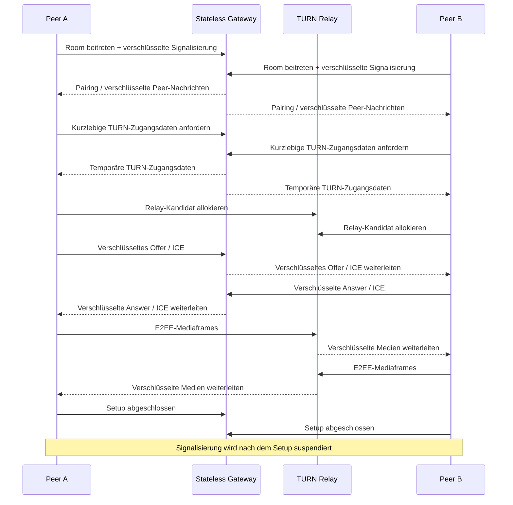

# LiveHide

### Datenschutzorientierte 1:1-Audio-/Videokommunikation mit Relay-only WebRTC und E2EE auf Anwendungsebene

  <a href="./README.md">English</a> ·
  <a href="./README.de.md"><strong>Deutsch</strong></a> ·
  <a href="./README.tr.md">Türkçe</a>

  
  
  
  

---

## ✨ Auf einen Blick

| | |
|---|---|
| 🎥 **Zweck** | Private 1:1-Audio-/Videoanrufe |
| 🌐 **Medientransport** | WebRTC ausschließlich über authentifizierte TURN-Relays |
| 🔐 **Medienschutz** | AES-256-GCM-E2EE auf Anwendungsebene über Encoded Transforms |
| 📡 **Signalisierung** | Verschlüsselte WebSocket-Signalisierung; kein Klartext-SDP/ICE im Signalisierungskanal |
| 🧠 **Gateway** | Zustandsloser Go-Dienst mit Room-State im Arbeitsspeicher und ohne Datenbank/Redis |
| 🧹 **Persistenzmodell** | Keine Browser-Persistenz; serverseitiger Zustand bleibt flüchtig |
| 🛡️ **Fehlermodell** | Fail-closed, wenn Datenschutz-/Sicherheitsbedingungen nicht erfüllt werden |

> [!NOTE]
> LiveHide wird als Engineering-Fallstudie veröffentlicht. Die Implementierung basiert auf strikten Datenschutz-Invarianten; produktive Sicherheitsbehauptungen müssen trotzdem gegen die finale Deployment-Konfiguration und das Threat Model geprüft werden.

## 🔎 Überblick

LiveHide ist eine datenschutzorientierte Echtzeit-Kommunikationsplattform für 1:1-Audio-/Videoanrufe. Anders als typische WebRTC-Anwendungen, die direkte Host- oder server-reflexive Kandidaten bevorzugen, erzwingt LiveHide bewusst **Relay-only WebRTC**. Dadurch gibt es keinen direkten Fallback-Pfad, der Netzwerkadressen gegenüber dem anderen Teilnehmer offenlegen kann. Der Medienpfad läuft über selbst betriebenes **coturn**, während die Medienframes zusätzlich auf Anwendungsebene Ende-zu-Ende verschlüsselt werden.

Signalisierungs- und Medienebene sind bewusst getrennt. Ein kleines **zustandsloses Go-Gateway** koordiniert Rooms, verschlüsselte Signalisierungs-Envelopes und kurzlebige TURN-Zugangsdaten, ist aber weder als dauerhafte Medienstation noch als persistenter Nutzerdatendienst ausgelegt.

## 🧠 Technischer Kern

LiveHide verwendet einen streng konfigurierten TypeScript/Vite-Browserclient und ein Gateway auf Basis der Go-Standardbibliothek. Beim Verbindungsaufbau authentifizieren die Clients die Peer-Beziehung, leiten kryptografischen Zustand ab, tauschen **verschlüsselte SDP/ICE-Signalisierung** aus, beziehen kurzlebige authentifizierte TURN-Zugangsdaten und erzeugen eine `RTCPeerConnection` mit `iceTransportPolicy: "relay"`. Host-, server-reflexive und peer-reflexive Kandidaten werden verworfen. Nach Abschluss von ICE prüft der Client über `RTCPeerConnection.getStats()`, welcher Kandidatenpfad tatsächlich gewählt wurde; ist dieser nicht TURN-relayed, wird der Anruf beendet, statt die Privatsphäre stillschweigend zu reduzieren. Medienframes werden zusätzlich über WebRTC Encoded Transforms in einem Dedicated Worker mit **AES-256-GCM** geschützt; eine Short Authentication String (SAS) ermöglicht beiden Teilnehmern die Peer-Verifikation. Auch Signalisierungsnachrichten werden in AES-256-GCM-Envelopes mit monotonen Sequenznummern und Additional Authenticated Data verpackt, um Manipulation und Replay zu verhindern. Nach erfolgreichem Setup wird die Signalisierungs-WebSocket-Verbindung bewusst suspendiert und nur für kontrollierte ICE-Restarts erneut geöffnet. Serverseitige Rooms leben ausschließlich im Arbeitsspeicher und werden beim Verlassen der Teilnehmer gelöscht; browserseitig werden localStorage, sessionStorage, IndexedDB und Cookies für Call-State vermieden.

### Kern-Stack

`Go` · `TypeScript` · `Vite` · `WebRTC` · `WebSocket` · `coturn` · `Caddy` · `Docker` · `WebCrypto`

## 🔄 Verbindungsablauf

Das Diagramm nutzt ausschließlich weit unterstützte Mermaid-Sequence-Syntax und rendert dadurch zuverlässig auf GitHub.

## ⚡ Engineering-Highlights

| Bereich | Implementierungsrichtung |
|---|---|
| 🧱 **Gateway** | Zustandsloser Go-Dienst; für Room-State keine Datenbank oder Redis notwendig |
| 🔐 **Signalisierung** | AES-256-GCM-Envelopes, Sequenzschutz und AAD-Bindung |
| 🌍 **Netzwerk-Privatsphäre** | TURN-only ICE-Policy; direkte Kandidaten werden gefiltert und verworfen |
| ✅ **Runtime-Verifikation** | Gewählter Relay-Kandidat wird über WebRTC-Stats geprüft, bevor der sichere Connected-State erreicht wird |
| 🎥 **Media E2EE** | Encoded Transforms / Dedicated Worker mit AES-256-GCM |
| 🔑 **Peer-Verifikation** | SAS-basierte Peer-Verifikation |
| 🎟️ **TURN-Authentifizierung** | Kurzlebige temporäre coturn-Zugangsdaten |
| 🧹 **Persistenz** | Kein Browser-Storage für Call-State; flüchtige In-Memory-Rooms |
| 🚪 **Fail Closed** | Fehler bei Sicherheits-/Privacy-Bedingungen beendet die Session statt herunterzustufen |
| 🔁 **Recovery** | Kontrolliertes Wiederöffnen der Signalisierung und ICE-Restart bei Netzwerkwechseln |

## 🛡️ Sicherheit & Datenschutz

LiveHide behandelt Datenschutzmerkmale als explizite State-Machine-Vorbedingungen und nicht nur als UI-Labels.

Der verbundene Zustand wird erst erreicht, wenn die erforderlichen Bedingungen erfüllt sind, darunter Peer-Authentifizierung, kryptografische Schlüsselableitung, TURN-Verfügbarkeit, WebRTC-Konnektivität, Relay-Pfad-Verifikation und installierte Media-Transforms.

Wichtige Designmerkmale:

- Relay-only WebRTC statt direktem Candidate-Fallback
- Verschlüsselte Signalisierung mit Replay-/Tamper-Schutz
- Media E2EE auf Anwendungsebene
- Temporäre TURN-Zugangsdaten
- Kein Klartext-SDP/ICE über das Gateway
- Keine persistente Room-Datenbank
- Keine Browser-Persistenz für Call-State
- Signalisierungs-Transport wird nach Setup beendet/suspendiert
- Explizites Fail-closed, wenn Relay-/E2EE-Anforderungen nicht erfüllt werden

> [!IMPORTANT]
> TURN-Relays transportieren weiterhin Netzwerkverkehr und bleiben damit Teil der Transportinfrastruktur. Das Privacy-Modell basiert auf authentifiziertem Relay-Einsatz plus Ende-zu-Ende-Medienverschlüsselung – nicht auf der Behauptung, es gebe keinen Intermediär.

## 🧪 Verifikation

Die Projektdokumentation enthält automatisierte Unit-, Race-, Security- und End-to-End-Prüfungen für unter anderem:

- WebSocket-Protokollhärtung
- Verschlüsselte Signalisierung
- Relay-only Candidate Enforcement
- Reale coturn-Integration
- Zwei-Browser-Audio-/Videoanrufe
- Media-E2EE auf Anwendungsebene
- Zero-Persistence-Prüfungen
- Negative / Fail-closed-Szenarien
- Kontrolliertes ICE-Restart-Verhalten

Die finale öffentliche Dokumentation wird die exakt reproduzierbaren Befehle zusammen mit dem bereinigten Source-Release veröffentlichen.

## 🎬 Demo

**Kommt bald.**

Die öffentliche Demo wird erst ergänzt, wenn die Deployment-Konfiguration dieselben Sicherheitsinvarianten wie der lokale bzw. Release-Build erhalten kann.

Geplant:

- Zwei-Browser-Call-Flow
- Visualisierung des Verbindungsstatus
- SAS-Verifikation
- Relay-Pfadstatus
- Mikrofon-/Kamerasteuerung
- Kurzes Produkt-Walkthrough-GIF
- Deployment-Hinweise

## 🖼️ Produktvorschau

| Call Interface | Security State | Connection Lifecycle |
|---|---|---|
| 🎥 Demnächst | 🛡️ Demnächst | ⚡ Demnächst |

## 🛣️ Projektstatus

- [x] Privacy-orientierte Architektur
- [x] Zustandsloses Go-Gateway
- [x] Verschlüsselte Signalisierung
- [x] TURN-only WebRTC-Transport
- [x] Media E2EE auf Anwendungsebene
- [x] SAS-Peer-Verifikation
- [x] Fail-closed Connection Checks
- [x] Zero-Persistence-Kontrollen
- [ ] Bereinigten Source veröffentlichen
- [ ] Screenshots und Produkt-GIF ergänzen
- [ ] Reproduzierbare technische Dokumentation veröffentlichen
- [ ] Öffentliche Demo deployen

## 💡 Warum dieses Projekt wichtig ist

LiveHide ist ein Networking- und Security-Engineering-Projekt und keine klassische CRUD-Anwendung. Es koordiniert Browser-Medienerfassung, kryptografischen State, WebSocket-Signalisierung, TURN-Allokation, WebRTC-Negotiation, Runtime-Transportverifikation und UI-Lifecycle, während das System bewusst ephemer bleibt.

`Real-Time Systems` · `WebRTC` · `Networking` · `Applied Cryptography` · `Privacy Engineering`

---

### Entwickelt von [Taha Kubilay](https://github.com/tahakubilay)

