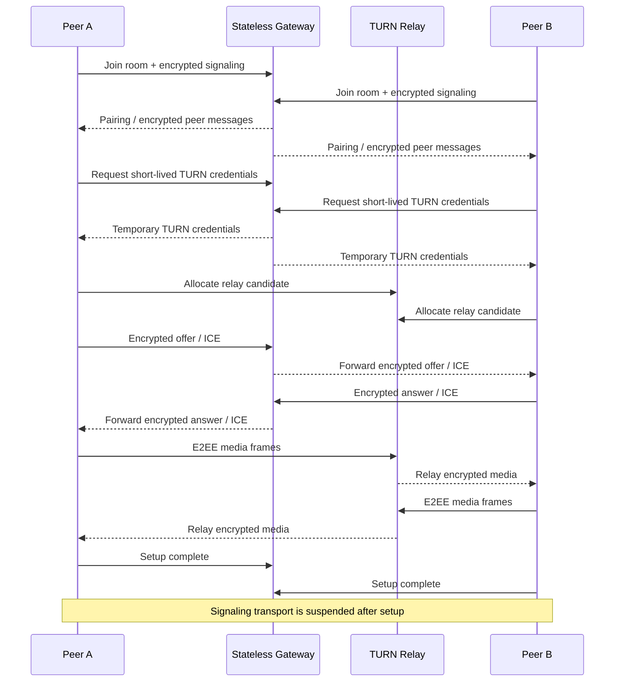

# LiveHide

### Datenschutzorientierte 1:1-Audio-/Videokommunikation mit Relay-only WebRTC und E2EE auf Anwendungsebene

  <a href="./README.md">English</a> ·
  <a href="./README.de.md"><strong>Deutsch</strong></a> ·
  <a href="./README.tr.md">Türkçe</a>

  
  
  
  

---

## ✨ Auf einen Blick

| | |
|---|---|
| 🎥 **Zweck** | Private 1:1-Audio-/Videoanrufe |
| 🌐 **Medientransport** | WebRTC ausschließlich über authentifizierte TURN-Relays |
| 🔐 **Medienschutz** | AES-256-GCM-E2EE auf Anwendungsebene über Encoded Transforms |
| 📡 **Signalisierung** | Verschlüsselte WebSocket-Signalisierung; kein Klartext-SDP/ICE im Signalisierungskanal |
| 🧠 **Gateway** | Zustandsloser Go-Dienst mit flüchtigem Room-State im Arbeitsspeicher und ohne Datenbank/Redis |
| 🧹 **Persistenzmodell** | Keine Browser-Persistenz; serverseitiger Zustand ist transient |
| 🛡️ **Fehlermodell** | Fail-closed, wenn Datenschutz-/Sicherheitsbedingungen nicht erfüllt sind |

> [!NOTE]
> LiveHide wird als Engineering-Fallstudie veröffentlicht. Die Implementierung basiert auf strikten Datenschutz-Invarianten; Aussagen zur produktiven Sicherheit müssen dennoch gegen die finale Deployment-Konfiguration und das Threat Model geprüft werden.

## 🧭 Schnellnavigation

[Overview](#-overview) · [Technical Core](#-technical-core) · [Connection Flow](#-connection-flow) · [Security](#-security--privacy) · [Demo](#-demo) · [Roadmap](#-project-status)

## 🔎 Überblick

LiveHide ist eine datenschutzorientierte Echtzeit-Kommunikationsplattform für 1:1-Audio-/Videoanrufe. Anders als klassische WebRTC-Anwendungen, die direkte Host- oder server-reflexive Kandidaten bevorzugen, erzwingt LiveHide bewusst **Relay-only WebRTC**, damit keine direkte Verbindung als Fallback entsteht, die Netzwerkadressen gegenüber dem anderen Teilnehmer offenlegen kann. Der Medienpfad läuft über selbst betriebenes **coturn**, während die Medienframes zusätzlich auf Anwendungsebene Ende-zu-Ende verschlüsselt werden.

Signalisierungs- und Medienebene sind strikt getrennt. Ein kleines **zustandsloses Go-Gateway** koordiniert Rooms, verschlüsselte Signalisierungs-Envelopes und kurzlebige TURN-Zugangsdaten, ist aber weder als dauerhafte Medienstation noch als persistenter Nutzerdatendienst ausgelegt.

## 🧠 Technischer Kern

LiveHide verwendet einen strikt konfigurierten TypeScript/Vite-Browserclient und ein Gateway auf Basis der Go-Standardbibliothek. Beim Verbindungsaufbau authentifizieren die Clients die Peer-Beziehung, leiten kryptografischen Zustand ab, tauschen **verschlüsselte SDP/ICE-Signalisierung** aus, beziehen kurzlebige authentifizierte TURN-Zugangsdaten und erzeugen eine `RTCPeerConnection` mit `iceTransportPolicy: "relay"`. Host-, server-reflexive und peer-reflexive Kandidaten werden verworfen. Nach Abschluss von ICE prüft der Client über `RTCPeerConnection.getStats()`, welcher Kandidatenpfad tatsächlich gewählt wurde; ist dieser nicht TURN-relayed, wird der Anruf beendet statt die Privatsphäre stillschweigend zu reduzieren. Medienframes werden zusätzlich über WebRTC Encoded Transforms in einem Dedicated Worker mit **AES-256-GCM** geschützt; eine Short Authentication String (SAS) ermöglicht beiden Teilnehmern die Peer-Verifikation. Auch Signalisierungsnachrichten werden in AES-256-GCM-Envelopes mit monotonen Sequenznummern und Additional Authenticated Data verpackt, um Manipulation und Replay zu verhindern. Nach erfolgreichem Setup wird die Signalisierungs-WebSocket-Verbindung bewusst pausiert und nur für kontrollierte ICE-Restarts wieder geöffnet. Serverseitige Rooms leben ausschließlich im Arbeitsspeicher und werden beim Verlassen der Teilnehmer gelöscht; browserseitig werden localStorage, sessionStorage, IndexedDB und Cookies für Call-State vermieden.

### Kern-Stack

`Go` · `TypeScript` · `Vite` · `WebRTC` · `WebSocket` · `coturn` · `Caddy` · `Docker` · `WebCrypto`

## 🔄 Verbindungsablauf

The diagram uses only widely supported Mermaid sequence syntax so it renders reliably on GitHub.

## ⚡ Engineering-Highlights

| Area | Implementation direction |
|---|---|
| 🧱 **Gateway** | Stateless Go service; no database or Redis required for room state |
| 🔐 **Signaling** | AES-256-GCM encrypted envelopes, sequence protection and AAD binding |
| 🌍 **Network Privacy** | TURN-only ICE policy; direct candidates are filtered and rejected |
| ✅ **Runtime Verification** | Selected relay candidate verified through WebRTC stats before secure connected state |
| 🎥 **Media E2EE** | Encoded transforms / Dedicated Worker with AES-256-GCM |
| 🔑 **Peer Verification** | SAS-based peer verification |
| 🎟️ **TURN Auth** | Short-lived temporary coturn credentials |
| 🧹 **Persistence** | No browser storage for call state; transient in-memory server rooms |
| 🚪 **Fail Closed** | Security/privacy precondition failure ends the session rather than downgrading |
| 🔁 **Recovery** | Controlled signaling reopen and ICE restart for network transitions |

## 🛡️ Sicherheit & Datenschutz

LiveHide treats privacy properties as explicit state-machine preconditions rather than UI labels.

The connected state is reached only after the required conditions are satisfied, including peer authentication, cryptographic key derivation, TURN availability, WebRTC connectivity, relay-path verification and media-transform installation.

Important design properties include:

- relay-only WebRTC instead of direct candidate fallback
- encrypted signaling with replay/tamper protection
- application-layer media E2EE
- temporary TURN credentials
- no plaintext SDP/ICE forwarding through the gateway
- no persistent room database
- no browser persistence for call state
- signaling transport shutdown after setup
- explicit fail-closed behavior when relay/E2EE requirements cannot be met

> [!IMPORTANT]
> TURN relays still carry network traffic and therefore remain part of the transport infrastructure. The privacy model is based on authenticated relay use plus end-to-end media encryption—not on pretending that no intermediary exists.

## 🧪 Verifikation

The project documentation includes automated unit, race, security and end-to-end checks covering areas such as:

- WebSocket protocol hardening
- encrypted signaling behavior
- relay-only candidate enforcement
- real coturn integration
- two-browser audio/video calls
- application-layer media encryption
- zero-persistence checks
- negative / fail-closed scenarios
- controlled ICE restart behavior

The final public documentation will publish the exact reproducible verification commands together with the sanitized source release.

## 🎬 Demo

**Coming soon.**

The public demo will be added only after the deployment configuration is ready to preserve the same security invariants as the local/release build.

Planned showcase:

- two-browser call flow
- connection-state visualization
- SAS verification
- relay-path status
- microphone/camera controls
- short product walkthrough GIF
- deployment notes

## 🖼️ Produktvorschau

| Call Interface | Security State | Connection Lifecycle |
|---|---|---|
| 🎥 Coming soon | 🛡️ Coming soon | ⚡ Coming soon |

## 🛣️ Projektstatus

- [x] Privacy-oriented architecture
- [x] Stateless Go gateway
- [x] Encrypted signaling
- [x] TURN-only WebRTC transport
- [x] Application-layer media E2EE
- [x] SAS peer verification
- [x] Fail-closed connection checks
- [x] Zero-persistence controls
- [ ] Publish sanitized source
- [ ] Add screenshots and product GIF
- [ ] Publish reproducible technical documentation
- [ ] Deploy public demo

## 💡 Warum dieses Projekt wichtig ist

LiveHide is a networking and security engineering project rather than a standard CRUD application. It coordinates browser media capture, cryptographic state, WebSocket signaling, TURN allocation, WebRTC negotiation, runtime transport verification and UI lifecycle while keeping the system intentionally ephemeral.

`Real-Time Systems` · `WebRTC` · `Networking` · `Applied Cryptography` · `Privacy Engineering`

---

### Built by [Taha Kubilay](https://github.com/tahakubilay)

[⬆ Back to top](#livehide)

