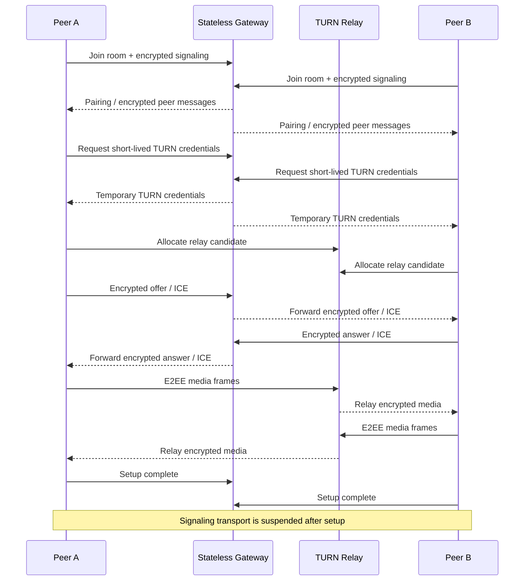

# LiveHide

### Privacy-first 1:1 audio/video communication with relay-only WebRTC and application-layer E2EE

  <a href="./README.md"><strong>English</strong></a> ·
  <a href="./README.de.md">Deutsch</a> ·
  <a href="./README.tr.md">Türkçe</a>

  
  
  
  

---

## ✨ At a Glance

| | |
|---|---|
| 🎥 **Purpose** | Private 1:1 audio/video calls |
| 🌐 **Media Transport** | WebRTC forced through authenticated TURN relays |
| 🔐 **Media Protection** | Application-layer AES-256-GCM E2EE using encoded transforms |
| 📡 **Signaling** | Encrypted WebSocket signaling; no plaintext SDP/ICE on the signaling channel |
| 🧠 **Gateway** | Stateless Go service with in-memory room state and no database/Redis dependency |
| 🧹 **Persistence Model** | Designed for zero browser persistence and transient server-side state |
| 🛡️ **Failure Model** | Fail closed if privacy/security preconditions are not satisfied |

> [!NOTE]
> LiveHide is being published as an engineering case study. The implementation has been built around strict privacy invariants; deployment claims should still be evaluated against the final production configuration and threat model.

## 🧭 Quick Navigation

[Overview](#-overview) · [Technical Core](#-technical-core) · [Connection Flow](#-connection-flow) · [Security](#-security--privacy) · [Demo](#-demo) · [Roadmap](#-project-status)

## 🔎 Overview

LiveHide is a privacy-first real-time communication platform for 1:1 audio/video calls. Unlike a conventional WebRTC app that prefers direct host/server-reflexive candidates, LiveHide intentionally uses **relay-only WebRTC** so peers do not fall back to a direct connection that can expose network addresses to the other participant. The media path is carried through self-hosted **coturn**, while the application layer separately protects media frames with end-to-end encryption.

The signaling plane is intentionally separated from the media plane. A small **stateless Go gateway** coordinates rooms, encrypted signaling envelopes and short-lived TURN credentials, but it is not designed to become a long-lived media intermediary or a persistent user-data service.

## 🧠 Technical Core

LiveHide uses a strict TypeScript/Vite browser client and a standard-library Go gateway. During call setup, the clients authenticate the peer relationship, derive cryptographic state, exchange **encrypted SDP/ICE signaling**, request short-lived authenticated TURN credentials and create an `RTCPeerConnection` configured with `iceTransportPolicy: "relay"`. Host, server-reflexive and peer-reflexive candidates are rejected, and after ICE completes the client verifies the actually selected candidate pair through `RTCPeerConnection.getStats()`; if the selected path is not a TURN relay, the call is terminated instead of silently degrading privacy. Media is additionally protected at the application layer using WebRTC encoded transforms in a Dedicated Worker with **AES-256-GCM**, while a Short Authentication String (SAS) lets the two users verify the peer relationship. Signaling messages are themselves wrapped in AES-256-GCM envelopes with monotonic sequence numbers and authenticated additional data, providing tamper/replay protection. After setup succeeds, the signaling WebSocket is deliberately suspended and reopened only when a controlled ICE restart is required. Server-side rooms live only in memory and are deleted when the participants leave; the browser side avoids localStorage, sessionStorage, IndexedDB and cookies for call state.

### Core stack

`Go` · `TypeScript` · `Vite` · `WebRTC` · `WebSocket` · `coturn` · `Caddy` · `Docker` · `WebCrypto`

## 🔄 Connection Flow

The diagram uses only widely supported Mermaid sequence syntax so it renders reliably on GitHub.

## ⚡ Engineering Highlights

| Area | Implementation direction |
|---|---|
| 🧱 **Gateway** | Stateless Go service; no database or Redis required for room state |
| 🔐 **Signaling** | AES-256-GCM encrypted envelopes, sequence protection and AAD binding |
| 🌍 **Network Privacy** | TURN-only ICE policy; direct candidates are filtered and rejected |
| ✅ **Runtime Verification** | Selected relay candidate verified through WebRTC stats before secure connected state |
| 🎥 **Media E2EE** | Encoded transforms / Dedicated Worker with AES-256-GCM |
| 🔑 **Peer Verification** | SAS-based peer verification |
| 🎟️ **TURN Auth** | Short-lived temporary coturn credentials |
| 🧹 **Persistence** | No browser storage for call state; transient in-memory server rooms |
| 🚪 **Fail Closed** | Security/privacy precondition failure ends the session rather than downgrading |
| 🔁 **Recovery** | Controlled signaling reopen and ICE restart for network transitions |

## 🛡️ Security & Privacy

LiveHide treats privacy properties as explicit state-machine preconditions rather than UI labels.

The connected state is reached only after the required conditions are satisfied, including peer authentication, cryptographic key derivation, TURN availability, WebRTC connectivity, relay-path verification and media-transform installation.

Important design properties include:

- relay-only WebRTC instead of direct candidate fallback
- encrypted signaling with replay/tamper protection
- application-layer media E2EE
- temporary TURN credentials
- no plaintext SDP/ICE forwarding through the gateway
- no persistent room database
- no browser persistence for call state
- signaling transport shutdown after setup
- explicit fail-closed behavior when relay/E2EE requirements cannot be met

> [!IMPORTANT]
> TURN relays still carry network traffic and therefore remain part of the transport infrastructure. The privacy model is based on authenticated relay use plus end-to-end media encryption—not on pretending that no intermediary exists.

## 🧪 Verification Direction

The project documentation includes automated unit, race, security and end-to-end checks covering areas such as:

- WebSocket protocol hardening
- encrypted signaling behavior
- relay-only candidate enforcement
- real coturn integration
- two-browser audio/video calls
- application-layer media encryption
- zero-persistence checks
- negative / fail-closed scenarios
- controlled ICE restart behavior

The final public documentation will publish the exact reproducible verification commands together with the sanitized source release.

## 🎬 Demo

**Coming soon.**

The public demo will be added only after the deployment configuration is ready to preserve the same security invariants as the local/release build.

Planned showcase:

- two-browser call flow
- connection-state visualization
- SAS verification
- relay-path status
- microphone/camera controls
- short product walkthrough GIF
- deployment notes

## 🖼️ Product Showcase

| Call Interface | Security State | Connection Lifecycle |
|---|---|---|
| 🎥 Coming soon | 🛡️ Coming soon | ⚡ Coming soon |

## 🛣️ Project Status

- [x] Privacy-oriented architecture
- [x] Stateless Go gateway
- [x] Encrypted signaling
- [x] TURN-only WebRTC transport
- [x] Application-layer media E2EE
- [x] SAS peer verification
- [x] Fail-closed connection checks
- [x] Zero-persistence controls
- [ ] Publish sanitized source
- [ ] Add screenshots and product GIF
- [ ] Publish reproducible technical documentation
- [ ] Deploy public demo

## 💡 Why This Project Matters

LiveHide is a networking and security engineering project rather than a standard CRUD application. It coordinates browser media capture, cryptographic state, WebSocket signaling, TURN allocation, WebRTC negotiation, runtime transport verification and UI lifecycle while keeping the system intentionally ephemeral.

`Real-Time Systems` · `WebRTC` · `Networking` · `Applied Cryptography` · `Privacy Engineering`

---

### Built by [Taha Kubilay](https://github.com/tahakubilay)

[⬆ Back to top](#livehide)

