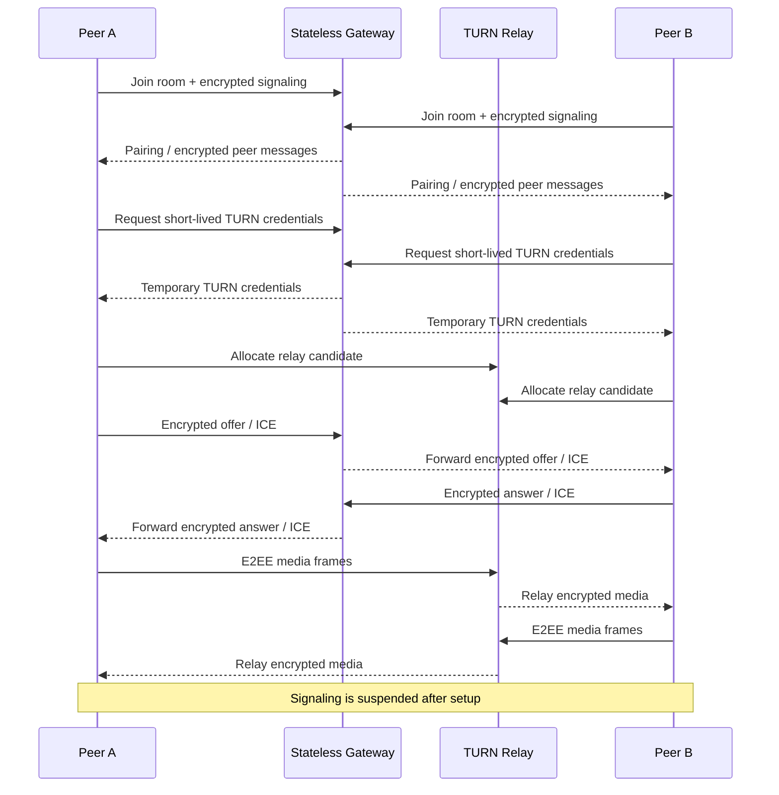

# LiveHide

### Privacy-first 1:1 audio/video communication with relay-only WebRTC and application-layer E2EE

<a href="./README.md"><strong>English</strong></a> · <a href="./README.de.md">Deutsch</a> · <a href="./README.tr.md">Türkçe</a>

  
  
  

---

## Overview

LiveHide is a privacy-first 1:1 audio/video communication system built around **relay-only WebRTC, encrypted signaling, application-layer end-to-end media encryption and fail-closed security checks**.

The architecture separates signaling from media transport. A Go gateway coordinates room membership, encrypted signaling messages and short-lived TURN credentials; authenticated TURN relays carry WebRTC traffic, while encoded media frames receive independent application-layer encryption. The relay remains part of the network trust boundary, but it is not intended to receive plaintext media.

## Technical Architecture

LiveHide uses a TypeScript/Vite browser client and a Go gateway built around a minimal server-side state model.

During call setup:

1. Peers join a room through the signaling gateway.
2. Peer relationship and cryptographic state are established.
3. SDP and ICE signaling messages are exchanged inside encrypted envelopes.
4. Clients request short-lived TURN credentials.
5. WebRTC is created with `iceTransportPolicy: "relay"`.
6. Host, server-reflexive and peer-reflexive candidates are rejected.
7. The selected candidate pair is verified through `RTCPeerConnection.getStats()`.
8. Application-layer media encryption is installed using WebRTC Encoded Transforms.
9. A Short Authentication String (SAS) is available for peer verification.
10. Signaling is suspended after setup and reopened only for controlled ICE recovery when needed.

### Core Stack

`Go` · `TypeScript` · `Vite` · `WebRTC` · `WebSocket` · `coturn` · `Caddy` · `Docker` · `WebCrypto`

## Technical Deep Dive

The privacy model is enforced at runtime rather than described only as a design goal. A call begins with room coordination through the Go signaling gateway, but the gateway does not receive plaintext SDP or ICE payloads. Signaling data is wrapped in authenticated AES-256-GCM envelopes, bound to message context through additional authenticated data and protected against replay through monotonically increasing sequence state.

Once the peer relationship is established, each client requests short-lived coturn credentials and creates its `RTCPeerConnection` with `iceTransportPolicy: "relay"`. The implementation does not rely on that browser option alone: host, server-reflexive and peer-reflexive candidates are filtered, and after ICE negotiation the selected candidate pair is inspected with `RTCPeerConnection.getStats()`. A session is not considered securely connected unless the active transport path is actually relayed.

Media confidentiality is enforced independently of TURN. Encoded audio/video frames pass through WebRTC Encoded Transforms and a Dedicated Worker, where application-layer AES-256-GCM protection is applied before frames are transmitted. This means the TURN server is responsible for relaying transport packets but is not trusted with plaintext media. A Short Authentication String (SAS) gives participants an out-of-band way to compare peer identity state and detect an unexpected key relationship.

The signaling channel is intentionally minimized after setup. Once transport and cryptographic prerequisites are satisfied, the WebSocket signaling path is suspended instead of remaining permanently open. It is re-established only when controlled ICE recovery is required, such as after a network transition. Room state remains ephemeral in gateway memory and is removed when the session ends.

The failure policy is deliberately strict. If relay verification, cryptographic setup, peer verification state or another required security invariant cannot be satisfied, LiveHide terminates the session rather than silently falling back to a less private connection mode.

## Connection Flow

## Why TURN-only?

Conventional WebRTC generally prefers the most direct path between peers because direct connectivity can reduce latency and relay cost. That behavior can also expose peer network addresses as part of ICE connectivity establishment.

LiveHide makes a different trade-off: it prioritizes network-address privacy over the efficiency of direct peer-to-peer routing. By forcing WebRTC through authenticated TURN relays, each participant communicates with the relay infrastructure instead of establishing a direct media path to the other peer.

TURN-only transport does **not** make the relay a trusted media endpoint. Application-layer E2EE is applied separately, so the relay can forward encrypted traffic without needing access to plaintext audio or video. The design therefore separates two concerns: TURN limits direct network exposure, while end-to-end media encryption limits what the relay can learn from the media it transports.

## Security Model

| Area | Design |
|---|---|
| **Network Path** | TURN-only WebRTC; direct candidates are filtered and rejected |
| **Runtime Verification** | Selected candidate pair is checked through WebRTC stats |
| **Signaling** | AES-256-GCM encrypted envelopes with sequence protection and AAD binding |
| **Media E2EE** | AES-256-GCM over WebRTC Encoded Transforms in a Dedicated Worker |
| **Peer Verification** | Short Authentication String (SAS) |
| **TURN Authentication** | Short-lived temporary coturn credentials |
| **Server State** | Ephemeral in-memory room state |
| **Browser Persistence** | No localStorage, sessionStorage, IndexedDB or cookie storage for call state |
| **Failure Handling** | Security precondition failures terminate the session rather than silently downgrade privacy |

LiveHide treats privacy guarantees as connection-state requirements instead of UI labels. A call reaches its secure connected state only after the required transport, cryptographic and verification conditions are satisfied.

> [!IMPORTANT]
> TURN relays still transport network traffic and remain part of the transport infrastructure. The privacy model is based on authenticated relay use plus end-to-end media encryption, not on the assumption that no intermediary exists.

## Verification

The project includes automated checks covering:

- WebSocket protocol hardening
- Encrypted signaling
- Relay-only candidate enforcement
- coturn integration
- Two-browser audio/video calls
- Application-layer media encryption
- Zero-persistence behavior
- Fail-closed scenarios
- Controlled ICE restart behavior
- Go race detection and security checks

## Engineering Focus

LiveHide combines real-time networking, applied cryptography and browser media APIs in one system.

`Real-Time Systems` · `WebRTC` · `Networking` · `Applied Cryptography` · `Privacy Engineering`

## License

LiveHide is licensed under the [Apache License, Version 2.0](./LICENSE).

---

### Built by [Taha Kubilay](https://github.com/tahakubilay)

