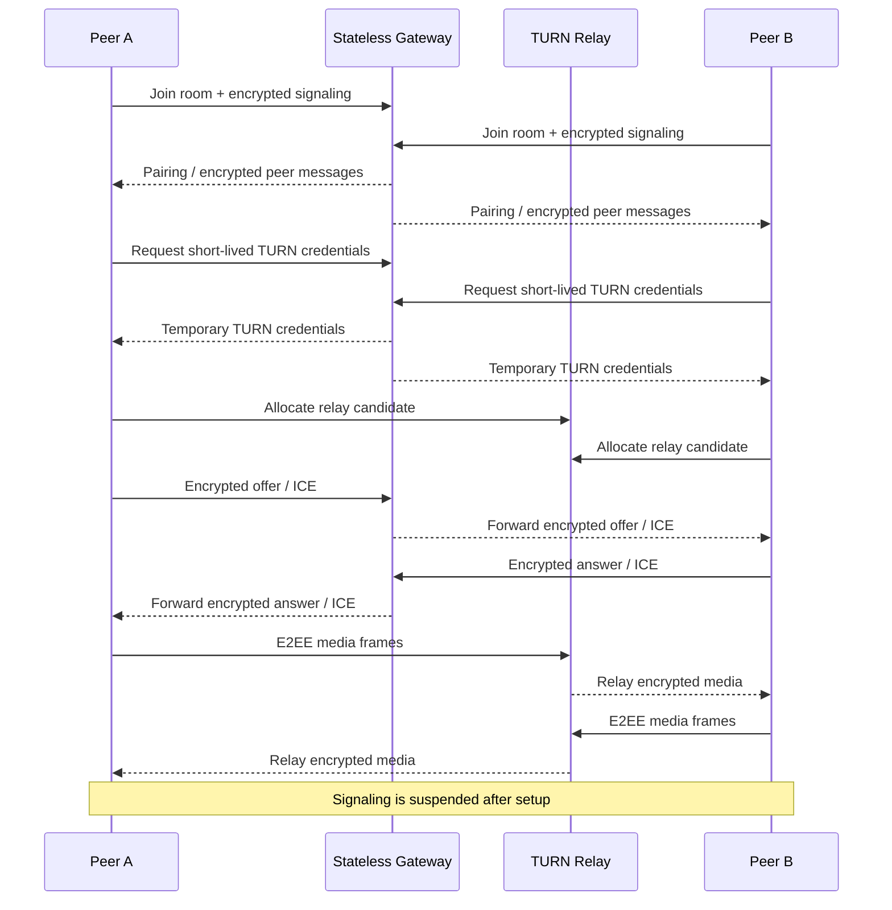

# LiveHide

### Privacy-first 1:1 audio/video communication with relay-only WebRTC and application-layer E2EE

<a href="./README.md"><strong>English</strong></a> · <a href="./README.de.md">Deutsch</a> · <a href="./README.tr.md">Türkçe</a>

  
  
  

---

## Overview

LiveHide is a privacy-focused real-time communication platform for 1:1 audio and video calls.

Its architecture separates signaling from media transport. A stateless Go gateway coordinates room membership, encrypted signaling messages and short-lived TURN credentials, while WebRTC media is forced through authenticated TURN relays and additionally protected with application-layer end-to-end encryption.

## Technical Architecture

LiveHide uses a TypeScript/Vite browser client and a Go gateway built around a minimal server-side state model.

During call setup:

1. Peers join a room through the signaling gateway.
2. Peer relationship and cryptographic state are established.
3. SDP and ICE signaling messages are exchanged inside encrypted envelopes.
4. Clients request short-lived TURN credentials.
5. WebRTC is created with `iceTransportPolicy: "relay"`.
6. Host, server-reflexive and peer-reflexive candidates are rejected.
7. The selected candidate pair is verified through `RTCPeerConnection.getStats()`.
8. Application-layer media encryption is installed using WebRTC Encoded Transforms.
9. A Short Authentication String (SAS) is available for peer verification.
10. Signaling is suspended after setup and reopened only for controlled ICE recovery when needed.

### Core Stack

`Go` · `TypeScript` · `Vite` · `WebRTC` · `WebSocket` · `coturn` · `Caddy` · `Docker` · `WebCrypto`

## Connection Flow

## Security Model

| Area | Design |
|---|---|
| **Network Path** | TURN-only WebRTC; direct candidates are filtered and rejected |
| **Runtime Verification** | Selected candidate pair is checked through WebRTC stats |
| **Signaling** | AES-256-GCM encrypted envelopes with sequence protection and AAD binding |
| **Media E2EE** | AES-256-GCM over WebRTC Encoded Transforms in a Dedicated Worker |
| **Peer Verification** | Short Authentication String (SAS) |
| **TURN Authentication** | Short-lived temporary coturn credentials |
| **Server State** | Ephemeral in-memory room state |
| **Browser Persistence** | No localStorage, sessionStorage, IndexedDB or cookie storage for call state |
| **Failure Handling** | Security precondition failures terminate the session rather than silently downgrade privacy |

LiveHide treats privacy guarantees as connection-state requirements instead of UI labels. A call reaches its secure connected state only after the required transport, cryptographic and verification conditions are satisfied.

> [!IMPORTANT]
> TURN relays still transport network traffic and remain part of the transport infrastructure. The privacy model is based on authenticated relay use plus end-to-end media encryption, not on the assumption that no intermediary exists.

## Verification

The project includes automated checks covering:

- WebSocket protocol hardening
- Encrypted signaling
- Relay-only candidate enforcement
- coturn integration
- Two-browser audio/video calls
- Application-layer media encryption
- Zero-persistence behavior
- Fail-closed scenarios
- Controlled ICE restart behavior
- Go race detection and security checks

## Engineering Focus

LiveHide combines real-time networking, applied cryptography and browser media APIs in one system.

`Real-Time Systems` · `WebRTC` · `Networking` · `Applied Cryptography` · `Privacy Engineering`

---

### Built by [Taha Kubilay](https://github.com/tahakubilay)

