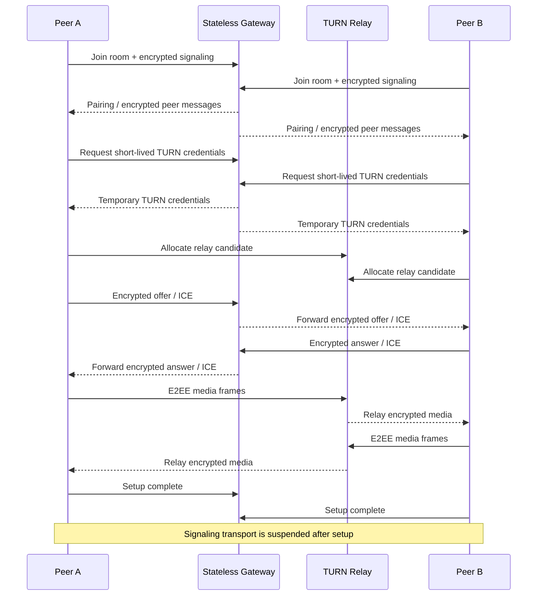

# LiveHide

### Relay-only WebRTC ve uygulama katmanı E2EE ile gizlilik odaklı 1:1 sesli/görüntülü iletişim

  <a href="./README.md">English</a> ·
  <a href="./README.de.md">Deutsch</a> ·
  <a href="./README.tr.md"><strong>Türkçe</strong></a>

  
  
  
  

---

## ✨ Genel Bakış

| | |
|---|---|
| 🎥 **Amaç** | Özel 1:1 sesli/görüntülü görüşmeler |
| 🌐 **Medya Taşıma** | Kimlik doğrulamalı TURN relay üzerinden zorunlu WebRTC |
| 🔐 **Medya Koruması** | Encoded Transform üzerinde uygulama katmanı AES-256-GCM E2EE |
| 📡 **Sinyalleşme** | Şifreli WebSocket signaling; signaling kanalında açık SDP/ICE yok |
| 🧠 **Gateway** | Veritabanı/Redis gerektirmeyen, odaları RAM'de tutan stateless Go servisi |
| 🧹 **Kalıcılık Modeli** | Tarayıcıda kalıcı depolama yok; sunucu durumu geçici |
| 🛡️ **Hata Modeli** | Güvenlik/gizlilik ön koşulları sağlanmazsa fail-closed |

> [!NOTE]
> LiveHide bir mühendislik vaka çalışması olarak yayınlanıyor. Uygulama sıkı gizlilik invariants üzerine kuruludur; production güvenlik iddiaları yine de nihai deployment konfigürasyonu ve threat model üzerinden değerlendirilmelidir.

## 🧭 Hızlı Gezinme

[Overview](#-overview) · [Technical Core](#-technical-core) · [Connection Flow](#-connection-flow) · [Security](#-security--privacy) · [Demo](#-demo) · [Roadmap](#-project-status)

## 🔎 Proje Özeti

LiveHide, 1:1 sesli/görüntülü görüşmeler için gizlilik odaklı bir gerçek zamanlı iletişim platformudur. Doğrudan host veya server-reflexive adayları tercih eden klasik WebRTC uygulamalarından farklı olarak LiveHide bilinçli biçimde **relay-only WebRTC** kullanır; böylece karşı tarafa ağ adresini açığa çıkarabilecek doğrudan bağlantıya fallback yapılmaz. Medya yolu self-hosted **coturn** üzerinden taşınırken, medya frame'leri ayrıca uygulama katmanında uçtan uca şifrelenir.

Signaling düzlemi medya düzleminden ayrı tutulur. Küçük ve **stateless bir Go gateway**, oda eşleşmesini, şifreli signaling envelope'larını ve kısa ömürlü TURN kimlik bilgilerini koordine eder; kalıcı medya aracı veya kullanıcı verisi saklayan bir servis olarak tasarlanmamıştır.

## 🧠 Teknik Çekirdek

LiveHide, strict TypeScript/Vite tarayıcı istemcisi ve yalnızca Go standard library üzerine kurulu bir gateway kullanır. Çağrı kurulurken istemciler peer ilişkisini doğrular, kriptografik durumu türetir, **şifreli SDP/ICE signaling** değiş tokuşu yapar, kısa ömürlü kimlik doğrulamalı TURN bilgilerini alır ve `iceTransportPolicy: "relay"` ile bir `RTCPeerConnection` oluşturur. Host, server-reflexive ve peer-reflexive adaylar reddedilir. ICE tamamlandıktan sonra istemci, gerçekte seçilen candidate pair'i `RTCPeerConnection.getStats()` üzerinden doğrular; yol TURN relay değilse gizliliği sessizce düşürmek yerine çağrı sonlandırılır. Medya ayrıca Dedicated Worker içinde WebRTC Encoded Transforms kullanılarak **AES-256-GCM** ile uygulama katmanında korunur; Short Authentication String (SAS), kullanıcıların peer ilişkisini manuel olarak doğrulamasını sağlar. Signaling mesajları da monoton sequence numaraları ve authenticated additional data içeren AES-256-GCM envelope'larıyla taşınır; bu yapı tamper ve replay saldırılarına karşı koruma sağlar. Kurulum tamamlandıktan sonra signaling WebSocket bilinçli olarak kapatılır/askıya alınır ve yalnız kontrollü ICE restart gerektiğinde tekrar açılır. Sunucu odaları yalnız RAM'de yaşar ve katılımcılar ayrıldığında silinir; tarayıcı tarafında çağrı durumu için localStorage, sessionStorage, IndexedDB ve cookie kullanılmaz.

### Temel teknoloji yığını

`Go` · `TypeScript` · `Vite` · `WebRTC` · `WebSocket` · `coturn` · `Caddy` · `Docker` · `WebCrypto`

## 🔄 Bağlantı Akışı

The diagram uses only widely supported Mermaid sequence syntax so it renders reliably on GitHub.

## ⚡ Mühendislik Öne Çıkanları

| Area | Implementation direction |
|---|---|
| 🧱 **Gateway** | Stateless Go service; no database or Redis required for room state |
| 🔐 **Signaling** | AES-256-GCM encrypted envelopes, sequence protection and AAD binding |
| 🌍 **Network Privacy** | TURN-only ICE policy; direct candidates are filtered and rejected |
| ✅ **Runtime Verification** | Selected relay candidate verified through WebRTC stats before secure connected state |
| 🎥 **Media E2EE** | Encoded transforms / Dedicated Worker with AES-256-GCM |
| 🔑 **Peer Verification** | SAS-based peer verification |
| 🎟️ **TURN Auth** | Short-lived temporary coturn credentials |
| 🧹 **Persistence** | No browser storage for call state; transient in-memory server rooms |
| 🚪 **Fail Closed** | Security/privacy precondition failure ends the session rather than downgrading |
| 🔁 **Recovery** | Controlled signaling reopen and ICE restart for network transitions |

## 🛡️ Güvenlik ve Gizlilik

LiveHide treats privacy properties as explicit state-machine preconditions rather than UI labels.

The connected state is reached only after the required conditions are satisfied, including peer authentication, cryptographic key derivation, TURN availability, WebRTC connectivity, relay-path verification and media-transform installation.

Important design properties include:

- relay-only WebRTC instead of direct candidate fallback
- encrypted signaling with replay/tamper protection
- application-layer media E2EE
- temporary TURN credentials
- no plaintext SDP/ICE forwarding through the gateway
- no persistent room database
- no browser persistence for call state
- signaling transport shutdown after setup
- explicit fail-closed behavior when relay/E2EE requirements cannot be met

> [!IMPORTANT]
> TURN relays still carry network traffic and therefore remain part of the transport infrastructure. The privacy model is based on authenticated relay use plus end-to-end media encryption—not on pretending that no intermediary exists.

## 🧪 Doğrulama

The project documentation includes automated unit, race, security and end-to-end checks covering areas such as:

- WebSocket protocol hardening
- encrypted signaling behavior
- relay-only candidate enforcement
- real coturn integration
- two-browser audio/video calls
- application-layer media encryption
- zero-persistence checks
- negative / fail-closed scenarios
- controlled ICE restart behavior

The final public documentation will publish the exact reproducible verification commands together with the sanitized source release.

## 🎬 Demo

**Coming soon.**

The public demo will be added only after the deployment configuration is ready to preserve the same security invariants as the local/release build.

Planned showcase:

- two-browser call flow
- connection-state visualization
- SAS verification
- relay-path status
- microphone/camera controls
- short product walkthrough GIF
- deployment notes

## 🖼️ Ürün Vitrini

| Call Interface | Security State | Connection Lifecycle |
|---|---|---|
| 🎥 Coming soon | 🛡️ Coming soon | ⚡ Coming soon |

## 🛣️ Proje Durumu

- [x] Privacy-oriented architecture
- [x] Stateless Go gateway
- [x] Encrypted signaling
- [x] TURN-only WebRTC transport
- [x] Application-layer media E2EE
- [x] SAS peer verification
- [x] Fail-closed connection checks
- [x] Zero-persistence controls
- [ ] Publish sanitized source
- [ ] Add screenshots and product GIF
- [ ] Publish reproducible technical documentation
- [ ] Deploy public demo

## 💡 Bu Proje Neden Önemli

LiveHide is a networking and security engineering project rather than a standard CRUD application. It coordinates browser media capture, cryptographic state, WebSocket signaling, TURN allocation, WebRTC negotiation, runtime transport verification and UI lifecycle while keeping the system intentionally ephemeral.

`Real-Time Systems` · `WebRTC` · `Networking` · `Applied Cryptography` · `Privacy Engineering`

---

### Built by [Taha Kubilay](https://github.com/tahakubilay)

[⬆ Back to top](#livehide)

