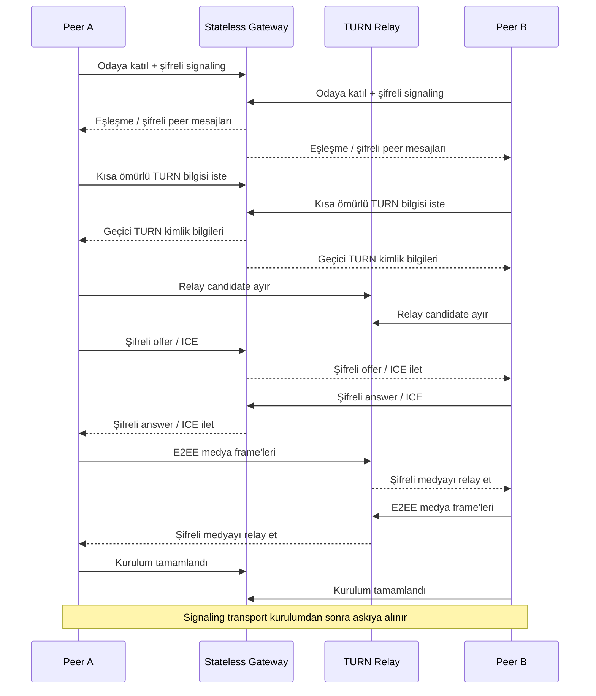

# LiveHide

### Relay-only WebRTC ve uygulama katmanı E2EE ile gizlilik odaklı 1:1 sesli/görüntülü iletişim

  <a href="./README.md">English</a> ·
  <a href="./README.de.md">Deutsch</a> ·
  <a href="./README.tr.md"><strong>Türkçe</strong></a>

  
  
  
  

---

## ✨ Kısaca

| | |
|---|---|
| 🎥 **Amaç** | Özel 1:1 sesli/görüntülü görüşmeler |
| 🌐 **Medya Taşıma** | Kimlik doğrulamalı TURN relay üzerinden zorunlu WebRTC |
| 🔐 **Medya Koruması** | Encoded Transform üzerinde uygulama katmanı AES-256-GCM E2EE |
| 📡 **Sinyalleşme** | Şifreli WebSocket signaling; signaling kanalında açık SDP/ICE yok |
| 🧠 **Gateway** | Veritabanı/Redis gerektirmeyen, odaları RAM'de tutan stateless Go servisi |
| 🧹 **Kalıcılık Modeli** | Tarayıcıda kalıcı depolama yok; sunucu durumu geçici |
| 🛡️ **Hata Modeli** | Güvenlik/gizlilik ön koşulları sağlanmazsa fail-closed |

> [!NOTE]
> LiveHide bir mühendislik vaka çalışması olarak yayınlanıyor. Uygulama sıkı gizlilik invariants üzerine kuruludur; production güvenlik iddiaları yine de nihai deployment konfigürasyonu ve threat model üzerinden değerlendirilmelidir.

## 🔎 Genel Bakış

LiveHide, 1:1 sesli/görüntülü görüşmeler için gizlilik odaklı bir gerçek zamanlı iletişim platformudur. Doğrudan host veya server-reflexive adayları tercih eden klasik WebRTC uygulamalarından farklı olarak LiveHide bilinçli biçimde **relay-only WebRTC** kullanır; böylece karşı tarafa ağ adresini açığa çıkarabilecek doğrudan bağlantıya fallback yapılmaz. Medya yolu self-hosted **coturn** üzerinden taşınırken, medya frame'leri ayrıca uygulama katmanında uçtan uca şifrelenir.

Signaling düzlemi medya düzleminden ayrı tutulur. Küçük ve **stateless bir Go gateway**, oda eşleşmesini, şifreli signaling envelope'larını ve kısa ömürlü TURN kimlik bilgilerini koordine eder; kalıcı medya aracı veya kullanıcı verisi saklayan bir servis olarak tasarlanmamıştır.

## 🧠 Teknik Çekirdek

LiveHide, strict TypeScript/Vite tarayıcı istemcisi ve yalnızca Go standard library üzerine kurulu bir gateway kullanır. Çağrı kurulurken istemciler peer ilişkisini doğrular, kriptografik durumu türetir, **şifreli SDP/ICE signaling** değiş tokuşu yapar, kısa ömürlü kimlik doğrulamalı TURN bilgilerini alır ve `iceTransportPolicy: "relay"` ile bir `RTCPeerConnection` oluşturur. Host, server-reflexive ve peer-reflexive adaylar reddedilir. ICE tamamlandıktan sonra istemci, gerçekte seçilen candidate pair'i `RTCPeerConnection.getStats()` üzerinden doğrular; yol TURN relay değilse gizliliği sessizce düşürmek yerine çağrı sonlandırılır. Medya ayrıca Dedicated Worker içinde WebRTC Encoded Transforms kullanılarak **AES-256-GCM** ile uygulama katmanında korunur; Short Authentication String (SAS), kullanıcıların peer ilişkisini manuel olarak doğrulamasını sağlar. Signaling mesajları da monoton sequence numaraları ve authenticated additional data içeren AES-256-GCM envelope'larıyla taşınır; bu yapı tamper ve replay saldırılarına karşı koruma sağlar. Kurulum tamamlandıktan sonra signaling WebSocket bilinçli olarak kapatılır/askıya alınır ve yalnız kontrollü ICE restart gerektiğinde tekrar açılır. Sunucu odaları yalnız RAM'de yaşar ve katılımcılar ayrıldığında silinir; tarayıcı tarafında çağrı durumu için localStorage, sessionStorage, IndexedDB ve cookie kullanılmaz.

### Temel teknoloji yığını

`Go` · `TypeScript` · `Vite` · `WebRTC` · `WebSocket` · `coturn` · `Caddy` · `Docker` · `WebCrypto`

## 🔄 Bağlantı Akışı

Diyagram, GitHub'da güvenilir şekilde render olması için yalnızca geniş desteklenen Mermaid sequence syntax kullanır.

## ⚡ Mühendislik Öne Çıkanları

| Alan | Implementasyon yönü |
|---|---|
| 🧱 **Gateway** | Stateless Go servisi; oda state'i için veritabanı veya Redis gerektirmez |
| 🔐 **Signaling** | AES-256-GCM encrypted envelope, sequence koruması ve AAD binding |
| 🌍 **Ağ Gizliliği** | TURN-only ICE policy; doğrudan candidate'lar filtrelenir ve reddedilir |
| ✅ **Runtime Doğrulama** | Güvenli connected state'e geçmeden önce seçilen relay candidate WebRTC stats üzerinden doğrulanır |
| 🎥 **Medya E2EE** | Encoded Transforms / Dedicated Worker ile AES-256-GCM |
| 🔑 **Peer Doğrulama** | SAS tabanlı peer verification |
| 🎟️ **TURN Auth** | Kısa ömürlü geçici coturn kimlik bilgileri |
| 🧹 **Kalıcılık** | Call state için browser storage yok; geçici in-memory odalar |
| 🚪 **Fail Closed** | Güvenlik/gizlilik ön koşulu başarısızsa session downgrade yerine sonlandırılır |
| 🔁 **Recovery** | Ağ geçişlerinde kontrollü signaling reopen ve ICE restart |

## 🛡️ Güvenlik ve Gizlilik

LiveHide gizlilik özelliklerini yalnızca UI etiketi olarak değil, state machine'in açık ön koşulları olarak ele alır.

Connected state'e ancak peer authentication, kriptografik key derivation, TURN availability, WebRTC bağlantısı, relay-path verification ve media transform kurulumu gibi zorunlu koşullar sağlandığında geçilir.

Önemli tasarım özellikleri:

- Doğrudan candidate fallback yerine relay-only WebRTC
- Replay/tamper korumalı şifreli signaling
- Uygulama katmanında media E2EE
- Geçici TURN kimlik bilgileri
- Gateway üzerinden plaintext SDP/ICE geçmemesi
- Kalıcı room veritabanı olmaması
- Call state için browser persistence olmaması
- Setup sonrası signaling transport'un kapatılması/askıya alınması
- Relay/E2EE gereksinimleri sağlanmazsa açık fail-closed davranışı

> [!IMPORTANT]
> TURN relay'ler yine de ağ trafiğini taşır ve transport altyapısının bir parçasıdır. Gizlilik modeli “arada hiçbir servis yok” iddiasına değil, kimlik doğrulamalı relay kullanımı ile uçtan uca medya şifrelemesinin birlikte uygulanmasına dayanır.

## 🧪 Doğrulama

Proje dokümantasyonu şu alanları kapsayan otomatik unit, race, security ve end-to-end kontrolleri içerir:

- WebSocket protokol hardening
- Şifreli signaling davranışı
- Relay-only candidate enforcement
- Gerçek coturn entegrasyonu
- İki tarayıcı arasında sesli/görüntülü çağrı
- Uygulama katmanı medya şifreleme
- Zero-persistence kontrolleri
- Negative / fail-closed senaryolar
- Kontrollü ICE restart davranışı

Final public dokümantasyon, sanitize edilmiş source release ile birlikte tekrar üretilebilir doğrulama komutlarını yayınlayacaktır.

## 🎬 Demo

**Yakında.**

Public demo yalnızca deployment konfigürasyonu local/release build ile aynı güvenlik invariants'ını koruyabildiğinde eklenecektir.

Planlanan showcase:

- İki tarayıcı arası çağrı akışı
- Bağlantı state görselleştirmesi
- SAS doğrulama
- Relay path durumu
- Mikrofon/kamera kontrolleri
- Kısa ürün walkthrough GIF'i
- Deployment notları

## 🖼️ Ürün Vitrini

| Çağrı Arayüzü | Güvenlik Durumu | Bağlantı Yaşam Döngüsü |
|---|---|---|
| 🎥 Yakında | 🛡️ Yakında | ⚡ Yakında |

## 🛣️ Proje Durumu

- [x] Gizlilik odaklı mimari
- [x] Stateless Go gateway
- [x] Şifreli signaling
- [x] TURN-only WebRTC transport
- [x] Uygulama katmanı media E2EE
- [x] SAS peer verification
- [x] Fail-closed connection kontrolleri
- [x] Zero-persistence kontrolleri
- [ ] Sanitize edilmiş source'u yayınla
- [ ] Ekran görüntüleri ve ürün GIF'i ekle
- [ ] Tekrar üretilebilir teknik dokümantasyonu yayınla
- [ ] Public demoyu deploy et

## 💡 Bu Proje Neden Önemli?

LiveHide standart bir CRUD uygulaması değil, networking ve security engineering projesidir. Tarayıcı medya yakalama, kriptografik state, WebSocket signaling, TURN allocation, WebRTC negotiation, runtime transport doğrulama ve UI lifecycle'ını koordine ederken sistemi bilinçli olarak geçici/ephemeral tutar.

`Real-Time Systems` · `WebRTC` · `Networking` · `Applied Cryptography` · `Privacy Engineering`

---

### Geliştiren: [Taha Kubilay](https://github.com/tahakubilay)

