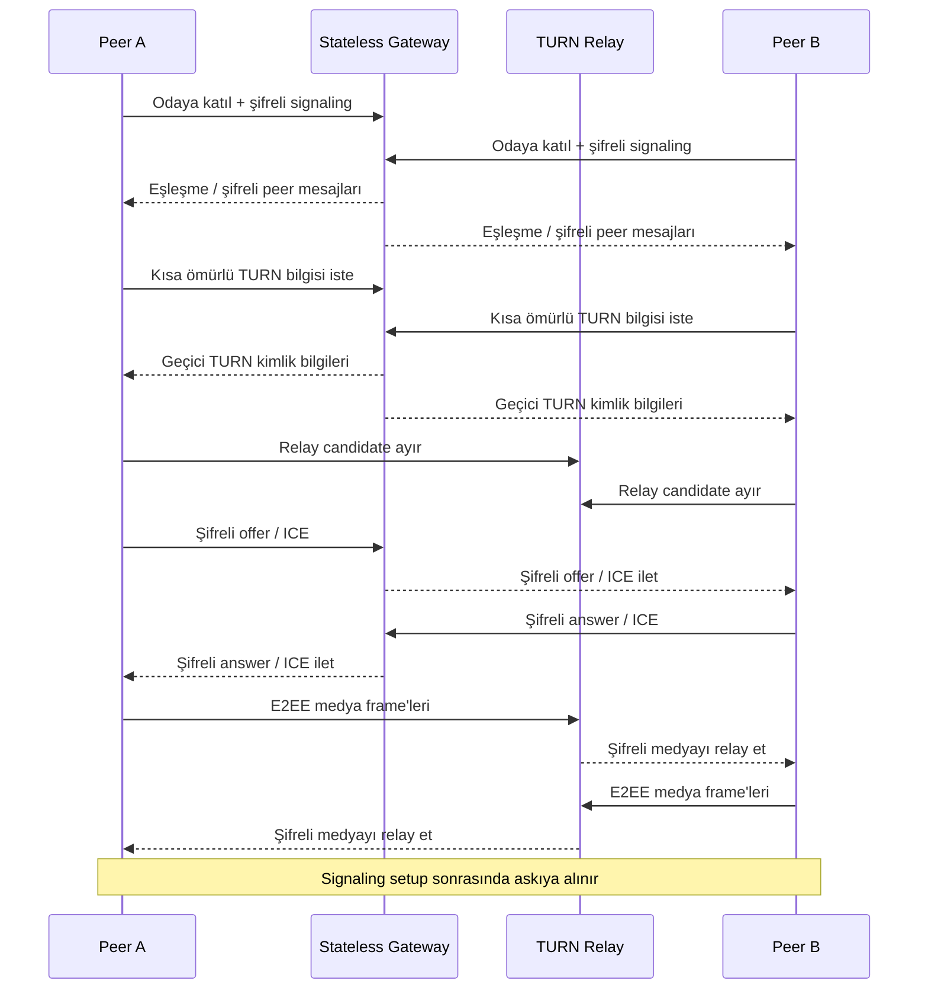

# LiveHide

### Relay-only WebRTC ve uygulama katmanı E2EE ile gizlilik odaklı 1:1 sesli/görüntülü iletişim

<a href="./README.md">English</a> · <a href="./README.de.md">Deutsch</a> · <a href="./README.tr.md"><strong>Türkçe</strong></a>

  
  
  

---

## Genel Bakış

LiveHide, 1:1 sesli ve görüntülü görüşmeler için gizlilik odaklı bir gerçek zamanlı iletişim platformudur.

Mimari, signaling ve medya taşıma katmanlarını birbirinden ayırır. Stateless Go gateway oda üyeliğini, şifreli signaling mesajlarını ve kısa ömürlü TURN kimlik bilgilerini koordine eder. WebRTC medyası yalnızca kimlik doğrulamalı TURN relay'ler üzerinden taşınır ve ayrıca uygulama katmanında uçtan uca şifrelenir.

## Teknik Mimari

LiveHide, TypeScript/Vite tarayıcı istemcisi ve minimum sunucu state'i kullanan bir Go gateway üzerine kuruludur.

Bağlantı kurulurken:

1. Peer'ler signaling gateway üzerinden bir odaya katılır.
2. Peer ilişkisi ve kriptografik state oluşturulur.
3. SDP ve ICE mesajları şifreli envelope'lar içinde değiş tokuş edilir.
4. İstemciler kısa ömürlü TURN kimlik bilgilerini alır.
5. WebRTC `iceTransportPolicy: "relay"` ile oluşturulur.
6. Host, server-reflexive ve peer-reflexive candidate'lar reddedilir.
7. Seçilen candidate pair `RTCPeerConnection.getStats()` üzerinden doğrulanır.
8. Uygulama katmanı medya şifreleme WebRTC Encoded Transforms ile kurulur.
9. Short Authentication String (SAS) peer doğrulaması sağlar.
10. Setup tamamlandığında signaling askıya alınır ve yalnız kontrollü ICE recovery gerektiğinde yeniden açılır.

### Temel Teknoloji Yığını

`Go` · `TypeScript` · `Vite` · `WebRTC` · `WebSocket` · `coturn` · `Caddy` · `Docker` · `WebCrypto`

## Bağlantı Akışı

## Güvenlik Modeli

| Alan | Tasarım |
|---|---|
| **Ağ Yolu** | TURN-only WebRTC; doğrudan candidate'lar filtrelenir ve reddedilir |
| **Runtime Doğrulama** | Seçilen candidate pair WebRTC stats üzerinden kontrol edilir |
| **Signaling** | Sequence koruması ve AAD binding içeren AES-256-GCM envelope'ları |
| **Medya E2EE** | Dedicated Worker içinde WebRTC Encoded Transforms üzerinde AES-256-GCM |
| **Peer Doğrulama** | Short Authentication String (SAS) |
| **TURN Kimlik Doğrulama** | Kısa ömürlü geçici coturn kimlik bilgileri |
| **Sunucu State'i** | RAM'de geçici oda state'i |
| **Tarayıcı Kalıcılığı** | Call state için localStorage, sessionStorage, IndexedDB veya cookie kullanılmaz |
| **Hata Davranışı** | Güvenlik ön koşulu başarısızsa session gizliliği düşürmek yerine sonlandırılır |

LiveHide gizlilik koşullarını bağlantı state'inin bir parçası olarak ele alır. Güvenli connected state'e ancak gerekli transport, kriptografi ve doğrulama koşulları sağlandığında geçilir.

> [!IMPORTANT]
> TURN relay'ler ağ trafiğini taşımaya devam eder ve transport altyapısının parçasıdır. Gizlilik modeli, kimlik doğrulamalı relay kullanımı ile uçtan uca medya şifrelemesinin birlikte uygulanmasına dayanır.

## Doğrulama

Otomatik test ve güvenlik kontrolleri şu alanları kapsar:

- WebSocket protokol hardening
- Şifreli signaling
- Relay-only candidate enforcement
- coturn entegrasyonu
- İki tarayıcı arasında sesli/görüntülü görüşme
- Uygulama katmanı medya şifreleme
- Zero-persistence davranışı
- Fail-closed senaryolar
- Kontrollü ICE restart
- Go race detection ve security checks

## Mühendislik Odağı

LiveHide; gerçek zamanlı networking, uygulamalı kriptografi ve browser media API'lerini tek sistemde bir araya getirir.

`Real-Time Systems` · `WebRTC` · `Networking` · `Applied Cryptography` · `Privacy Engineering`

---

### Geliştiren: [Taha Kubilay](https://github.com/tahakubilay)

